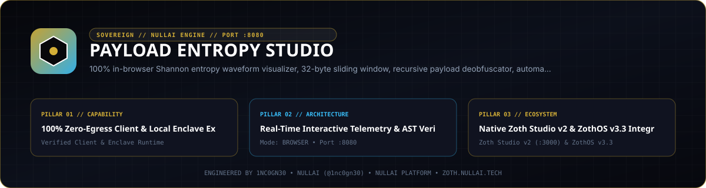
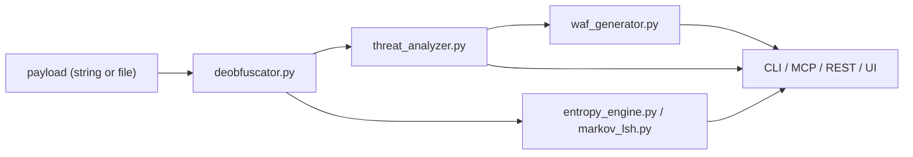

<div align="center">
  
</div>

# Payload & Entropy Studio

[](https://github.com/1nc0gn30/payload-entropy-studio/actions/workflows/ci.yml)
[](LICENSE)
[](#port)

Offline payload analyzer for security work: classifies attack strings (SQLi, XSS, command injection, traversal, SSTI, SSRF, XXE, prototype pollution), recursively de-obfuscates encoded input, profiles Shannon entropy and byte distribution, fingerprints payloads with SimHash/MinHash, flags shellcode patterns, and generates WAF / IDS rules. Ships as a Python CLI, a stdio MCP server, a loopback REST API, and a browser UI. The Python runtime uses only the standard library.

- Zoth Studio v2 dossier: https://zoth.nullai.tech/tools/payload-entropy-studio
- Web build: https://entropystudio.nullai.tech
- Source: https://github.com/1nc0gn30/payload-entropy-studio

## What It Does

- **Threat analysis** — regex signature matching across the major web attack classes, a 0-100 risk score, severity, and CWE / MITRE ATT&CK mappings.
- **De-obfuscation** — repeatedly unwraps URL encoding (including double/triple), hex escapes, Unicode escapes, Base64, HTML entities, and string concatenation, recording each layer.
- **Entropy profiling** — global and sliding-window Shannon entropy (0-8 bits/byte), 256-bin byte histogram, character-class ratios, and a zlib compression ratio as a practical Kolmogorov-complexity bound.
- **Markov / n-gram analysis** — transition entropy and KL divergence against text and HTTP baselines.
- **Locality-sensitive fingerprints** — 64-bit SimHash with Hamming distance and MinHash Jaccard estimates for near-duplicate clustering.
- **Shellcode heuristics** — NOP sleds, GetPC sequences, `syscall` / `int 0x80`, XOR decoder loops, non-printable density.
- **Polyglot and AST evasion checks** — dual-context payloads, magic-byte mismatches, obfuscated script / query grammar.
- **WAF rule synthesis** — ModSecurity (OWASP CRS style), Cloudflare expressions, AWS WAF v2 JSON, and Suricata rules derived from the analysis.

Entropy classes used by `entropy_engine.py`:

| Shannon entropy (bits/byte) | Class |
| :--- | :--- |
| < 4.5 | `NORMAL_TEXT` |
| 4.5 - 5.5 | `CODE_SCRIPT` |
| 5.5 - 6.8 | `OBFUSCATED_DATA` |
| 6.8 - 8.0 | `HIGH_ENTROPY_PACKED` |

## How It Works



| Module | Responsibility |
| :--- | :--- |
| `threat_analyzer.py` | Signature matching, scoring, CWE / ATT&CK mapping |
| `deobfuscator.py` | Recursive decoding layers |
| `entropy_engine.py` | Shannon entropy, sliding window, byte histogram, randomness tests |
| `markov_lsh.py` | Markov transition entropy, KL divergence, SimHash, MinHash, shellcode heuristics |
| `polyglot_analyzer.py` | Polyglot / magic-byte checks |
| `ast_obfuscation_detector.py` | Script and query grammar evasion |
| `waf_generator.py` | ModSecurity, Cloudflare, AWS WAF, Suricata output |
| `ui_server.py` | Threaded HTTP server for `public/` and `/api/*` |
| `mcp_server.py` | JSON-RPC 2.0 MCP server over stdio |
| `cli.py` | argparse CLI |

Launchers:

- `server.py` — starts `ui_server` on `127.0.0.1:8080` (`PORT` / `HOST` env override).
- `bin/payload-entropy.js` — Node wrapper. `payload-entropy web` runs `server.py`; no arguments (or `desktop` / `--gui`) opens the Electron shell in `electron/main.cjs`, falling back to the web server if Electron is not installed; anything else is forwarded to the Python CLI.
- `bin/payload-entropy-studio-tui` — Braille-sparkline terminal view (`--json`, `--benchmark`, `--frames N`).
- `payload-entropy.desktop` — Linux desktop entry calling `payload-entropy desktop` / `payload-entropy web`.

## Install

Requires Python 3.9+. Node.js is only needed for `bin/payload-entropy.js` and the optional Electron shell.

```bash
git clone https://github.com/1nc0gn30/payload-entropy-studio.git
cd payload-entropy-studio
python3 -m pip install -e .

# Verify
payload-entropy --version
payload-entropy --help

# Start the web UI + REST API on http://127.0.0.1:8080
python3 server.py
# or: npm start
# or: payload-entropy serve
```

Optional desktop shell:

```bash
npm install
npm run app
```

## CLI Reference

Entry points: `payload-entropy` and `payloadviz` (both `payload_entropy_studio.cli:main`); `python3 -m payload_entropy_studio` also works. The npm `bin` additionally exposes `payload-entropy-studio` via `bin/payload-entropy.js`. `payload` arguments accept a literal string or a file path. All analysis subcommands accept `--no-color`.

| Command | Purpose |
| :--- | :--- |
| `--json` | Print diagnostics as JSON |
| `--status` | Probe `http://127.0.0.1:8080/health` and print a JSON status object |
| `analyze PAYLOAD [--json]` | Threat analysis report |
| `deobfuscate PAYLOAD [--json]` | Decoding layers |
| `entropy PAYLOAD [-w N] [--json]` | Entropy profile (sliding window default 32) |
| `waf PAYLOAD [-t all\|modsecurity\|cloudflare\|aws\|suricata]` | WAF / IDS rules |
| `polyglot PAYLOAD [--json]` | Polyglot / magic-byte audit |
| `ast PAYLOAD [--json]` | Grammar evasion analysis |
| `markov PAYLOAD [-n ORDER] [--json]` | n-gram / Markov profile |
| `lsh` / `simhash` / `fingerprint PAYLOAD [-c OTHER] [--json]` | SimHash / MinHash, optional comparison |
| `shellcode PAYLOAD [--json]` | Shellcode heuristics |
| `serve [--host H] [--port P]` | Web UI + REST API (default `127.0.0.1:8080`) |
| `status [--host H] [--port P]` | Same as `--status` with explicit target |
| `mcp` | MCP stdio server |
| `doctor` / `diagnostics` / `platform [--json]` | Diagnostics |
| `test-self` | Built-in self-check |

Examples:

```bash
payload-entropy analyze "%3Cscript%3Ealert(document.cookie)%3C/script%3E" --json
payload-entropy deobfuscate "%252e%252e%252f%252e%252e%252fetc%2fpasswd"
payload-entropy entropy ./sample.bin -w 64
payload-entropy waf "1' UNION SELECT 1,username,password FROM users--" -t modsecurity
payload-entropy lsh "<script>alert(1)</script>" -c "<script>alert(2)</script>"
```

## MCP and REST Reference

### MCP (stdio)

```json
{
  "mcpServers": {
    "payload-entropy": {
      "command": "python3",
      "args": ["-m", "payload_entropy_studio", "mcp"]
    }
  }
}
```

Tools: `payload_analyze`, `payload_deobfuscate`, `payload_entropy`, `payload_waf_rules`, `payload_diagnostics`, `payload_polyglot_audit`, `payload_ast_obfuscation`, `payload_markov_profile`, `payload_lsh_fingerprint`, `payload_detect_shellcode`.

### REST (`server.py`, `127.0.0.1:8080`)

`POST` routes take `{"payload": "..."}` and reject non-localhost `Origin` headers.

| Method | Route | Description |
| :--- | :--- | :--- |
| `GET` | `/health`, `/api/health` | Health, version, uptime |
| `GET` | `/api/diagnostics` | Platform info |
| `POST` | `/api/analyze` | Threat analysis |
| `POST` | `/api/deobfuscate` | Decoding layers |
| `POST` | `/api/entropy` | Entropy profile |
| `POST` | `/api/waf` | WAF rules |
| `POST` | `/api/polyglot` | Polyglot audit |
| `POST` | `/api/ast-obfuscation` | Grammar evasion analysis |
| `POST` | `/api/markov` | Markov profile |
| `POST` | `/api/lsh` | SimHash / MinHash |
| `POST` | `/api/shellcode` | Shellcode heuristics |

```bash
curl -s http://127.0.0.1:8080/health
curl -s -X POST http://127.0.0.1:8080/api/analyze -H 'Content-Type: application/json' -d '{"payload":"<script>alert(1)</script>"}'
```

## Port

`127.0.0.1:8080` — matches the `payload-entropy-studio` entry in Zoth Studio v2 `tools.json`. Override with `PORT` (for `server.py`, `bin/payload-entropy.js`, `electron/main.cjs`) or `PAYLOAD_ENTROPY_PORT` / `--port` (for `payload-entropy serve`). On ZothOS v3.4.0 the `payload-entropy` binary and `payload-entropy.desktop` launcher use the same port.

## Testing

```bash
python3 -m pip install pytest
python3 -m pytest -q          # or: npm test
payload-entropy test-self
```

Server tests bind to ephemeral ports. `scripts/verify_ui.py` is an optional Playwright harness for triple-viewport UI checks against a running server (`PAYLOAD_ENTROPY_URL`).

## License

MIT. Copyright (c) 2026 [1nc0gn30](https://1nc0gn30.si) and [NullAI](https://nullai.tech). See [LICENSE](LICENSE).

Free and open source. Optional support: [Buy Us a Coffee (Stripe)](https://buy.stripe.com/3cIfZg27PdKo2D64Ocfw40X).
